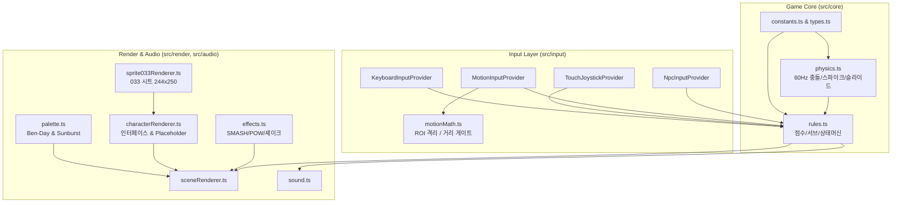

# 피카츄 배구 (Pop Art Edition) Implementation Plan

> **For agentic workers:** REQUIRED SUB-SKILL: Use superpowers:subagent-driven-development to implement this plan task-by-task. Steps use checkbox (`- [ ]`) syntax for tracking.

**Goal:** 모션인식(좌우 분할·월경 차단·거리 게이트)과 터치패드(1P/2P 다이나믹 조이스틱·위쪽 점프·자동 스파이크/슬라이드)를 모두 지원하는 팝아트 스타일 피카츄 배구 웹 앱(`033` 스프라이트 적용)을 구축한다.

**Architecture:** 순수 TypeScript 게임 코어(`src/core/`: 물리, 규칙, NPC AI)를 입력 어댑터(`src/input/`: 모션, 터치 조이스틱, 키보드)와 렌더러(`src/render/`: 팝아트 씬, `CharacterRenderer` 추상화 및 `033` 스프라이트 시트 렌더러)로부터 완전히 분리한다. 모션인식은 웹캠 영상을 좌/우 반쪽 ROI 캔버스로 물리 분할해 독립된 MediaPipe `PoseLandmarker`를 실행하고, 경계 침범 필터와 바운딩 박스 크기 게이트(`STEP BACK!`)를 순수 수학 모듈(`motionMath.ts`)에서 처리한다.

**Architecture Diagram:**



**Tech Stack:** TypeScript 5, Vite, HTML5 Canvas 2D, `@mediapipe/tasks-vision` (`PoseLandmarker`), Web Audio API, Vitest (`jsdom` for pointer/DOM tests)

**Spec:** [2026-11-23-pikachu-volleyball-design.md](file:///c:/Antigravity/volleyball/docs/superpowers/specs/2026-11-23-pikachu-volleyball-design.md)

## Global Constraints

- 가상 게임 월드 좌표: `864 × 608`, `FLOOR_Y = 536`, `NET_X = 432`, `NET_WIDTH = 16`, `NET_TOP_Y = 368`
- 고정 물리 타임스텝: `FIXED_DT = 1 / 60`
- 모션인식 거리 게이트 임계치: `TOO_CLOSE` (`widthRatio > 0.58 || heightRatio > 0.85`), 해제 `OK` (`widthRatio <= 0.48 && heightRatio <= 0.76`를 `0.5s` 이상 유지)
- 터치 다이나믹 조이스틱: `MAX_RADIUS = 56`, `DEADZONE = 0.15`, 점프 임계치 `normY < -0.45`
- 스프라이트 `033` 시트 규격: `C:\Antigravity\sprite\sprites\033\actions_out\*_sheet.png` (셀 `244 × 250 px`, 4행 `DOWN=0, RIGHT=1, UP=2, LEFT=3`)
- 모든 팝아트 요소: 검정 잉크 외곽선(`3~4px #111111`), 하드 드롭 섀도우(`4px 4px 0 #111111`), 벤데이 도트 패턴 사용
- `src/core/` 및 `src/input/motionMath.ts`는 DOM/브라우저 API에 의존하지 않는 순수 TypeScript로 유지한다.

---

### Task 1: 프로젝트 스캐폴딩, Vite/Vitest 설정 및 `033` 스프라이트 에셋 배치

**Files:**
- Create: `package.json`
- Create: `tsconfig.json`
- Create: `vite.config.ts`
- Create: `index.html`
- Create: `src/style.css`
- Copy Assets: `C:\Antigravity\sprite\sprites\033\actions_out\*_sheet.png` & `actions_manifest.json` -> `public/sprites/033/`
- Test: `tests/smoke.test.ts`

**Interfaces:**
- Produces: 빌드/테스트 스크립트(`npm run dev`, `npm run build`, `npm test`), 정적 에셋 `/sprites/033/actions_manifest.json`

- [ ] **Step 1: Git 저장소 초기화 및 스캐폴드 설정 파일 생성**

Run:
```powershell
git init
```

Create `package.json`:
```json
{
  "name": "pikachu-volleyball-popart",
  "private": true,
  "version": "0.1.0",
  "type": "module",
  "scripts": {
    "dev": "vite",
    "build": "tsc --noEmit && vite build",
    "preview": "vite preview",
    "test": "vitest run",
    "test:watch": "vitest"
  },
  "dependencies": {
    "@mediapipe/tasks-vision": "^0.10.18"
  },
  "devDependencies": {
    "jsdom": "^25.0.1",
    "typescript": "^5.6.3",
    "vite": "^6.0.1",
    "vitest": "^2.1.6"
  }
}
```

Create `tsconfig.json`:
```json
{
  "compilerOptions": {
    "target": "ES2022",
    "useDefineForClassFields": true,
    "module": "ESNext",
    "lib": ["ES2022", "DOM", "DOM.Iterable"],
    "skipLibCheck": true,
    "moduleResolution": "bundler",
    "allowImportingTsExtensions": true,
    "isolatedModules": true,
    "moduleDetection": "force",
    "noEmit": true,
    "strict": true,
    "noUnusedLocals": true,
    "noUnusedParameters": true
  },
  "include": ["src", "tests"]
}
```

Create `vite.config.ts`:
```ts
import { defineConfig } from 'vite';

export default defineConfig({
  server: {
    host: true,
    port: 5173
  },
  test: {
    environment: 'node',
    include: ['tests/**/*.test.ts']
  }
});
```

- [ ] **Step 2: `033` 스프라이트 시트 복사 및 스모크 테스트 작성**

Copy `actions_manifest.json` and `*_sheet.png` from `C:\Antigravity\sprite\sprites\033\actions_out\` to `public/sprites/033/`.

Create `tests/smoke.test.ts`:
```ts
import { describe, expect, it } from 'vitest';
import { readFileSync } from 'node:fs';
import { resolve } from 'node:path';

describe('033 sprite manifest', () => {
  it('loads copied actions_manifest.json with required volleyball actions', () => {
    const raw = readFileSync(resolve('public/sprites/033/actions_manifest.json'), 'utf8');
    const manifest = JSON.parse(raw);
    expect(manifest.character_id).toBe('033');
    for (const key of ['idle', 'walk', 'run', 'jump_launch', 'air_float', 'spike', 'slide', 'hurt', 'attack']) {
      expect(manifest.actions[key]).toBeDefined();
    }
  });
});
```

- [ ] **Step 3: 의존성 설치 및 스모크 테스트 실행**

Run:
```powershell
npm install
npm test
```
Expected: `1 passed` (`tests/smoke.test.ts`).

- [ ] **Step 4: Pop-Art 기본 `index.html` 및 `src/style.css` 작성**

Create `index.html`:
```html
<!doctype html>
<html lang="ko">
  <head>
    <meta charset="UTF-8" />
    <meta name="viewport" content="width=device-width, initial-scale=1.0, maximum-scale=1.0, user-scalable=no" />
    <title>PIKA VOLLEYBALL // POP ART EDITION</title>
  </head>
  <body>
    <div id="app">
      <canvas id="game-canvas"></canvas>
      <div id="ui-overlay"></div>
    </div>
    <video id="webcam-video" playsinline muted style="display:none"></video>
    <script type="module" src="/src/main.ts"></script>
  </body>
</html>
```

Create `src/style.css` with bold comic borders (`4px solid #111`), hard drop shadows (`5px 5px 0 #111`), `touch-action: none` on `#app` / `#game-canvas`, and responsive full-viewport canvas layout.

- [ ] **Step 5: Commit**

```bash
git add package.json tsconfig.json vite.config.ts index.html src/style.css public/sprites/033 tests/smoke.test.ts docs/superpowers/specs/2026-11-23-pikachu-volleyball-design.md
git commit -m "chore: scaffold vite typescript project and copy 033 sprites"
```

---

### Task 2: 코어 타입, 상수 및 물리 엔진 (`physics.ts`: 중력, 네트, 자동 스파이크, 자동 다이빙 슬라이드)

**Files:**
- Create: `src/core/types.ts`
- Create: `src/core/constants.ts`
- Create: `src/core/physics.ts`
- Test: `tests/physics.test.ts`

**Interfaces:**
- Produces: `WORLD`, `PlayerInput`, `PlayerState`, `BallState`, `PhysicsEvents`, `stepPhysics(players, ball, inputs, dt)`

- [ ] **Step 1: Write failing tests for physics (`tests/physics.test.ts`)**

```ts
import { describe, expect, it } from 'vitest';
import { WORLD } from '../src/core/constants';
import { createInitialBall, createInitialPlayer, stepPhysics } from '../src/core/physics';

describe('stepPhysics', () => {
  it('keeps P1 inside left court and P2 inside right court', () => {
    const p1 = createInitialPlayer('p1');
    const p2 = createInitialPlayer('p2');
    p1.x = WORLD.NET_LEFT - WORLD.PLAYER_RADIUS - 1;
    p2.x = WORLD.NET_RIGHT + WORLD.PLAYER_RADIUS + 1;
    const ball = createInitialBall('p1');

    for (let i = 0; i < 20; i++) {
      stepPhysics([p1, p2], ball, [
        { moveX: 1, targetX: null, jump: false },
        { moveX: -1, targetX: null, jump: false },
      ], WORLD.FIXED_DT);
    }

    expect(p1.x).toBeLessThanOrEqual(WORLD.NET_LEFT - WORLD.PLAYER_RADIUS);
    expect(p2.x).toBeGreaterThanOrEqual(WORLD.NET_RIGHT + WORLD.PLAYER_RADIUS);
  });

  it('triggers jump when grounded and jump=true', () => {
    const p1 = createInitialPlayer('p1');
    const p2 = createInitialPlayer('p2');
    const ball = createInitialBall('p1');
    stepPhysics([p1, p2], ball, [
      { moveX: 0, targetX: null, jump: true },
      { moveX: 0, targetX: null, jump: false },
    ], WORLD.FIXED_DT);
    expect(p1.isGrounded).toBe(false);
    expect(p1.vy).toBeLessThan(0);
  });

  it('automatically triggers spike when airborne player hits the ball', () => {
    const p1 = createInitialPlayer('p1');
    const p2 = createInitialPlayer('p2');
    p1.x = 220;
    p1.y = 320;
    p1.isGrounded = false;
    const ball = createInitialBall('p1');
    ball.x = 250;
    ball.y = 290;
    ball.vx = 0;
    ball.vy = 100;

    const events = stepPhysics([p1, p2], ball, [
      { moveX: 1, targetX: null, jump: false },
      { moveX: 0, targetX: null, jump: false },
    ], WORLD.FIXED_DT);

    expect(events.spikedBy).toBe('p1');
    expect(ball.isSpiked).toBe(true);
    expect(ball.vx).toBeGreaterThan(500);
    expect(p1.animLock).toBe('spike');
  });

  it('automatically triggers diving slide when sprinting toward low falling ball', () => {
    const p1 = createInitialPlayer('p1');
    const p2 = createInitialPlayer('p2');
    p1.x = 120;
    const ball = createInitialBall('p1');
    ball.x = 220;
    ball.y = WORLD.FLOOR_Y - 110;
    ball.vy = 260;

    const events = stepPhysics([p1, p2], ball, [
      { moveX: 1, targetX: null, jump: false },
      { moveX: 0, targetX: null, jump: false },
    ], WORLD.FIXED_DT);

    expect(events.slidBy).toBe('p1');
    expect(p1.slideTimer).toBeGreaterThan(0);
    expect(p1.animLock).toBe('slide');
  });

  it('reports ground contact side for scoring', () => {
    const p1 = createInitialPlayer('p1');
    const p2 = createInitialPlayer('p2');
    const ball = createInitialBall('p2');
    ball.x = WORLD.NET_X + 180;
    ball.y = WORLD.FLOOR_Y - WORLD.BALL_RADIUS + 4;
    ball.vy = 200;

    const events = stepPhysics([p1, p2], ball, [
      { moveX: 0, targetX: null, jump: false },
      { moveX: 0, targetX: null, jump: false },
    ], WORLD.FIXED_DT);

    expect(events.ballHitFloorSide).toBe('right');
  });
});
```

- [ ] **Step 2: Run test to verify it fails**

Run: `npm test`
Expected: FAIL (`Cannot find module '../src/core/constants'`).

- [ ] **Step 3: Implement `src/core/constants.ts`, `src/core/types.ts`, and `src/core/physics.ts`**

Write `src/core/constants.ts`:
- `WORLD` constants (`WIDTH: 864`, `HEIGHT: 608`, `FLOOR_Y: 536`, `NET_X: 432`, `NET_WIDTH: 16`, `NET_LEFT: 424`, `NET_RIGHT: 440`, `NET_TOP_Y: 368`, `PLAYER_RADIUS: 38`, `BALL_RADIUS: 32`, `FIXED_DT: 1 / 60`, `PLAYER_MOVE_SPEED: 420`, `PLAYER_JUMP_VY: -690`, `GRAVITY: 1650`, `SLIDE_SPEED: 620`, `SLIDE_DURATION: 0.34`, `SLIDE_COOLDOWN: 0.45`, `BALL_GRAVITY: 1080`, `BALL_MAX_SPEED: 980`, `SPIKE_SPEED: 880`).

Write `src/core/types.ts`:
- `PlayerId` (`'p1' | 'p2'`), `ControlMode` (`'touch' | 'motion'`), `OpponentMode` (`'npc' | '2p'`), `MatchPhase` (`'MENU' | 'WAITING_DISTANCE' | 'READY_SERVE' | 'PLAYING' | 'POINT_SCORED' | 'MATCH_OVER'`), `CharacterAnimState` (`'idle' | 'walk' | 'run' | 'jump_launch' | 'air_float' | 'spike' | 'slide' | 'attack' | 'hurt' | 'win' | 'lose'`), `PlayerInput`, `PlayerState`, `BallState`, `MotionSideStatus`, `GameState`.

Write `src/core/physics.ts`:
- `createInitialPlayer(id)`, `createInitialBall(serveSide)`
- `stepPhysics(players, ball, inputs, dt)` handling:
  - `targetX` tracking or `moveX` velocity
  - Auto-slide trigger check before horizontal integration
  - Jump & gravity + floor landing
  - Court boundary clamping (`[PLAYER_RADIUS, NET_LEFT - PLAYER_RADIUS]` for p1, `[NET_RIGHT + PLAYER_RADIUS, WIDTH - PLAYER_RADIUS]` for p2)
  - Ball gravity, ceiling/outer-wall bounce, net post & net top circular cap collision
  - Player-ball circle collision: if `!player.isGrounded`, apply directional spike (`SPIKE_SPEED`) toward opponent court and set `animLock = 'spike'`; if grounded, apply crisp upward volley bounce and set `animLock = 'attack'`.
  - Floor hit detection returning `ballHitFloorSide: 'left' | 'right' | null`.

- [ ] **Step 4: Run tests to verify they pass**

Run: `npm test`
Expected: PASS (`tests/physics.test.ts` 5/5).

- [ ] **Step 5: Commit**

```bash
git add src/core/constants.ts src/core/types.ts src/core/physics.ts tests/physics.test.ts
git commit -m "feat(core): add volleyball constants, types, and 60Hz physics engine"
```

---

### Task 3: 경기 규칙 상태 머신 (`rules.ts`) & 1P NPC AI (`npc.ts`)

**Files:**
- Create: `src/core/rules.ts`
- Create: `src/core/npc.ts`
- Test: `tests/rules.test.ts`
- Test: `tests/npc.test.ts`

**Interfaces:**
- Consumes: `src/core/types.ts`, `src/core/constants.ts`, `src/core/physics.ts`
- Produces: `createGameState(options)`, `stepGame(state, inputs, dt)`, `computeNpcInput(state, npcId)`

- [ ] **Step 1: Write failing tests for `rules.ts` and `npc.ts`**

Create `tests/rules.test.ts`:
- Verifies `READY_SERVE` transitions to `PLAYING` after `0.7s`.
- Verifies right-side ball floor hit awards point to `p1`, sets `phase = 'POINT_SCORED'`, and next serve belongs to `p1`.
- Verifies reaching `targetScore` (e.g. `5`) transitions to `MATCH_OVER` with `winner = 'p1'`.
- Verifies `WAITING_DISTANCE` freezes physics until `motionGateOk` becomes `true`.

Create `tests/npc.test.ts`:
- Verifies NPC moves toward predicted ball landing X when ball enters right court with rightward velocity.
- Verifies NPC triggers `jump: true` when ball approaches striking height above NPC.
- Verifies NPC returns toward center of right court (`NET_X + 216`) when ball is far on P1's side.

- [ ] **Step 2: Run tests to verify failure**

Run: `npm test`
Expected: FAIL (`Cannot find module '../src/core/rules'`).

- [ ] **Step 3: Implement `src/core/rules.ts` and `src/core/npc.ts`**

- `rules.ts`:
  - `createGameState({ controlMode, opponentMode, targetScore = 15 })`
  - `resetRound(state, serveSide)`
  - `stepGame(state, inputs, dt, motionReady = true)`: handles `WAITING_DISTANCE` pause/resume, `READY_SERVE` countdown, `PLAYING` step calling `stepPhysics`, `POINT_SCORED` pause (`1.1s`) -> next serve or `MATCH_OVER`, and populates `events` (for audio & pop-art bursts).
  - Derives each player's `animState` (`win`, `lose`, `hurt`, `spike`, `slide`, `attack`, `jump_launch`, `air_float`, `run`, `walk`, `idle`) cleanly.
- `npc.ts`:
  - `predictBallLandingX(ball, maxSteps = 120)`: pure ballistic step simulation including wall bounce (`0..WORLD.WIDTH`).
  - `computeNpcInput(state, npcId = 'p2')`: moves toward predicted landing X (or center defense `(WORLD.NET_RIGHT + WORLD.WIDTH) / 2`), jumps when ball is within horizontal reach `< 95` and height `[FLOOR_Y - 260, FLOOR_Y - 120]`, aims spike toward left court (`moveX = -1`).

- [ ] **Step 4: Run tests to verify pass**

Run: `npm test`
Expected: PASS (`tests/rules.test.ts` and `tests/npc.test.ts`).

- [ ] **Step 5: Commit**

```bash
git add src/core/rules.ts src/core/npc.ts tests/rules.test.ts tests/npc.test.ts
git commit -m "feat(core): implement match rules state machine and predictive NPC AI"
```

---

### Task 4: 모션인식 순수 연산 모듈 (`motionMath.ts`) — 좌/우 ROI 격리, 월경 차단, 거리 게이트

**Files:**
- Create: `src/input/motionMath.ts`
- Test: `tests/motionMath.test.ts`

**Interfaces:**
- Consumes: `WORLD` from `src/core/constants.ts`
- Produces: `NormalizedLandmark`, `SideTrackerState`, `createSideTrackerState()`, `evaluateSidePose(side, landmarks, tracker, dt)` returning `{ detected, targetX, jump, widthRatio, heightRatio, gateStatus: 'NO_PERSON' | 'TOO_CLOSE' | 'OK' }`

- [ ] **Step 1: Write failing tests for cross-over isolation and distance gate (`tests/motionMath.test.ts`)**

Test cases:
1. **좌/우 ROI 좌표 매핑**: Left ROI `torsoX = 0.5` maps to center of P1 court; Right ROI `torsoX = 0.5` maps to center of P2 court.
2. **월경(반대편 침범) 랜드마크 무시**: Right side has an established anchor at `x = 0.65`. If a stray/invading landmark cluster appears near the divider edge (`x = 0.06` in Right ROI, i.e. jump `|newX - anchorX| > 0.35`), `evaluateSidePose` rejects the hijack and keeps the established anchor instead of snapping P2 to the net!
3. **크기/거리 체크**:
   - Bounding box `widthRatio = 0.64` -> `gateStatus = 'TOO_CLOSE'`.
   - Bounding box drops to `widthRatio = 0.42, heightRatio = 0.65` for `0.2s` -> still `'TOO_CLOSE'` (hysteresis wait).
   - Sustained for `0.55s` -> transitions to `'OK'`.
4. **점프 인식**: Sudden upward hip/shoulder rise (`baselineHipY - hipY > 0.06`) or wrist raised above `nose.y - 0.04` -> `jump = true`.

- [ ] **Step 2: Run test to verify failure**

Run: `npm test`
Expected: FAIL (`Cannot find module '../src/input/motionMath'`).

- [ ] **Step 3: Implement `src/input/motionMath.ts`**

Implement pure deterministic functions:
- `extractVisibleBox(landmarks)` filtering `visibility >= 0.45`
- Divider-edge intrusion guard (`DIVIDER_MARGIN = 0.14`, `MAX_ANCHOR_JUMP = 0.35`)
- EMA smoothing (`alpha = 0.35`) for `smoothedCenterX` -> court X clamping
- Baseline Y tracking + jump/hands-up detection
- Hysteresis gate timer (`okHoldSeconds >= 0.5`)

- [ ] **Step 4: Run tests to verify pass**

Run: `npm test`
Expected: PASS (`tests/motionMath.test.ts`).

- [ ] **Step 5: Commit**

```bash
git add src/input/motionMath.ts tests/motionMath.test.ts
git commit -m "feat(input): add pure motion isolation and distance-gate math module"
```

---

### Task 5: 터치패드 다이나믹 조이스틱 (`touchJoystick.ts`), 키보드 (`keyboard.ts`), MediaPipe 어댑터 (`motion.ts`)

**Files:**
- Create: `src/input/types.ts`
- Create: `src/input/keyboard.ts`
- Create: `src/input/touchJoystick.ts`
- Create: `src/input/motion.ts`
- Test: `tests/touchJoystick.test.ts`

**Interfaces:**
- Consumes: `src/core/types.ts`, `src/input/motionMath.ts`
- Produces: `InputProvider`, `TouchJoystickProvider` (with `getActiveJoysticks()` for Pop-Art rendering), `KeyboardInputProvider`, `MotionInputProvider`

- [ ] **Step 1: Write failing tests for 1P/2P dynamic joystick (`tests/touchJoystick.test.ts`)**

Test with pure pointer coordinate calls (`handlePointerDown(id, x, y, viewportWidth)`, `handlePointerMove(...)`, `handlePointerUp(...)`):
1. In `1p` mode, touching anywhere spawns P1 joystick at `(x, y)`; dragging `(dx: +45, dy: -35)` produces `moveX > 0.7` and `jump === true` (`-35 / 56 = -0.625 < -0.45`).
2. Within `DEADZONE` (`dx: 5, dy: 4`), `moveX === 0` and `jump === false`.
3. In `2p` mode (`viewportWidth = 1000`), pointer `id=1` at `x=200` controls P1, simultaneous pointer `id=2` at `x=800` controls P2 independently; releasing `id=1` resets P1 without affecting P2.

- [ ] **Step 2: Run test to verify failure**

Run: `npm test`
Expected: FAIL (`Cannot find module '../src/input/touchJoystick'`).

- [ ] **Step 3: Implement `src/input/types.ts`, `touchJoystick.ts`, `keyboard.ts`, and `motion.ts`**

- `touchJoystick.ts`: Stores `Map<number, JoystickState>` keyed by `pointerId`, binds DOM `pointerdown`/`pointermove`/`pointerup`/`pointercancel` listeners cleanly with `dispose()`, exposes `getVisualJoysticks()` so `sceneRenderer.ts` draws the dynamic Pop-Art joysticks.
- `keyboard.ts`: `WASD` (`W`=jump, `A/D`=move) for P1, `Arrow` keys (`ArrowUp`=jump, `ArrowLeft/Right`=move) for P2 (or P1 in 1P mode).
- `motion.ts`: Uses `@mediapipe/tasks-vision` `FilesetResolver` + two independent `PoseLandmarker` instances (`leftLandmarker`, `rightLandmarker`, `numPoses: 1`), mirrors `<video>` into `640×240` offscreen buffer, copies `0..320` to `leftCanvas` and `320..640` to `rightCanvas`, runs `evaluateSidePose`, and exposes `getPreviewBuffer()` + `MotionSideStatus` for the Pop-Art HUD & `"STEP BACK!"` gate. Includes graceful error reporting when webcam permission is denied or unavailable.

- [ ] **Step 4: Run tests to verify pass**

Run: `npm test`
Expected: PASS (`tests/touchJoystick.test.ts` + all prior tests).

- [ ] **Step 5: Commit**

```bash
git add src/input/types.ts src/input/keyboard.ts src/input/touchJoystick.ts src/input/motion.ts tests/touchJoystick.test.ts
git commit -m "feat(input): add dynamic multi-touch joystick, keyboard, and ROI motion providers"
```

---

### Task 6: 팝아트 비주얼 시스템, 코믹 이펙트 & `033` 스프라이트 렌더러 (`src/render/`, `src/audio/`)

**Files:**
- Create: `src/render/palette.ts`
- Create: `src/render/characterRenderer.ts`
- Create: `src/render/sprite033Renderer.ts`
- Create: `src/render/effects.ts`
- Create: `src/render/sceneRenderer.ts`
- Create: `src/audio/sound.ts`
- Test: `tests/sprite033Renderer.test.ts`

**Interfaces:**
- Consumes: `GameState` from `src/core/types.ts`, `actions_manifest.json` from `/sprites/033/`
- Produces: `CharacterRenderer`, `PlaceholderCharacterRenderer`, `Sprite033Renderer`, `PopArtSceneRenderer`, `PopArtAudio`

- [ ] **Step 1: Write failing unit tests for `033` frame/row calculation (`tests/sprite033Renderer.test.ts`)**

Test pure frame selection helper `computeSpriteSlice(animState, facing, animTime, manifest)`:
1. Maps `animState = 'slide'`, `facing = 1` -> sheet `'slide'`, row `1` (`RIGHT`), cell `244×250`.
2. Maps `animState = 'spike'`, `facing = -1` -> sheet `'spike'`, row `3` (`LEFT`), frame index clamped/looped accurately within `5` frames at `12fps`.
3. Maps `'win'` fallback to `'idle'` row `0` (`DOWN`) and `'lose'` fallback to `'hurt'` last frame when dedicated sheets aren't present in manifest.

- [ ] **Step 2: Run test to verify failure**

Run: `npm test`
Expected: FAIL (`Cannot find module '../src/render/sprite033Renderer'`).

- [ ] **Step 3: Implement `palette.ts`, `characterRenderer.ts`, `sprite033Renderer.ts`, `effects.ts`, `sceneRenderer.ts`, and `sound.ts`**

- `palette.ts`: Pop-Art CMYK palette constants (`YELLOW: '#FFE600'`, `CYAN: '#00D4FF'`, `MAGENTA: '#FF2E93'`, `ORANGE: '#FFB703'`, `CREAM: '#FFFDF5'`, `INK: '#111111'`), offscreen cached Ben-Day halftone `CanvasPattern` & Sunburst background generator.
- `characterRenderer.ts`: `CharacterRenderer` interface + `PlaceholderCharacterRenderer` (geometric Pop-Art character with lightning ears, bold `#111` ink outline, squash & stretch).
- `sprite033Renderer.ts`: Loads `/sprites/033/actions_manifest.json` and the 9 PNG sheets (`244×250` grid), draws P1/P2 team ring + Pop-Art color aura/badge beneath character so both players using `033` are visually distinct, falls back cleanly to `PlaceholderCharacterRenderer` while loading.
- `effects.ts`: Comic burst badges (`"SMASH!"`, `"DIVE!"`, `"POW!"`, `"POINT!"`), halftone ball trail, screen-shake decay.
- `sceneRenderer.ts`: Renders Sunburst + Ben-Day court, Pop-Art net with halftone shadow, webcam split-screen frame (in Motion mode) with `"STEP BACK! 멀리 떨어지세요"` Pop-Art alert + distance gauge, dynamic joystick bases/knobs (in Touch mode), comic scoreboard.
- `sound.ts`: Web Audio API oscillator/noise synth for jump, volley, spike, dive, score fanfare, with mute toggle.

- [ ] **Step 4: Run tests to verify pass**

Run: `npm test`
Expected: PASS (`tests/sprite033Renderer.test.ts` + all prior tests).

- [ ] **Step 5: Commit**

```bash
git add src/render/ src/audio/ tests/sprite033Renderer.test.ts
git commit -m "feat(render,audio): implement Pop Art scene, comic effects, 033 sprite renderer, and synth SFX"
```

---

### Task 7: 팝아트 UI 메뉴, 앱 루프 통합 (`src/ui/menu.ts`, `src/main.ts`) 및 전체 검증

**Files:**
- Create: `src/ui/menu.ts`
- Create: `src/main.ts`

**Interfaces:**
- Consumes: `src/core/rules.ts`, `src/core/npc.ts`, `src/input/*`, `src/render/*`, `src/audio/sound.ts`
- Produces: Complete playable app with Pop-Art title screen, mode selector (모션인식 1P/2P, 터치패드 1P/2P), score selector (5/10/15), camera fallback modal, pause/restart, mute toggle.

- [ ] **Step 1: Implement `src/ui/menu.ts`**

- Pop-Art comic card menu overlay:
  - Mode cards: **모션인식 모드 (웹캠)** / **터치패드 모드 (다이나믹 조이스틱)**
  - Player count: **1P (vs NPC)** / **2P (로컬 대전)**
  - Target score selector: **5점 / 10점 / 15점**
  - Sprite toggle (테스트용 기본 `033` 스프라이트 ↔ 임시 모델 전환 디버그 토글)
  - Camera permission/error banner with instant "터치패드 모드로 전환" button.

- [ ] **Step 2: Implement `src/main.ts`**

- Fixed-timestep (`1/60s`) `requestAnimationFrame` loop with accumulator clamping.
- Wires active `InputProvider`s (`MotionInputProvider`, `TouchJoystickProvider` + `KeyboardInputProvider`, `NpcInputProvider`), feeds `stepGame()`, triggers `PopArtAudio` & `EffectsManager` on events, renders via `PopArtSceneRenderer`.
- Responsive canvas scaling preserving `864×608` aspect ratio with crisp DPR support.

- [ ] **Step 3: Run full verification suite (tests, typecheck, production build)**

Run:
```powershell
npm test
npm run build
```
Expected: All Vitest suites PASS, `tsc --noEmit` exits 0, `vite build` succeeds cleanly.

- [ ] **Step 4: Live browser verification**

Start `npm run dev` and inspect in browser:
- Verify Pop-Art title menu, `033` sprite rendering in court, 1P vs NPC gameplay with keyboard/touch dynamic joystick, 2P split dynamic joystick rendering, and Motion mode UI/fallback behavior.

- [ ] **Step 5: Commit**

```bash
git add src/ui/menu.ts src/main.ts
git commit -m "feat(app): wire Pop Art menu UI and main 60Hz game loop"
```

---

## Self-Review Checklist (Spec Coverage Check)
- [x] **두 가지 모드 (모션인식 / 터치패드)**: Task 5, Task 7
- [x] **모션인식 좌우 반 분할 & 월경 무효화**: Task 4 (`motionMath.ts` + tests), Task 5 (`motion.ts` dual cropped ROI)
- [x] **모션 크기/거리 체크 ("멀리 떨어지세요" + 임계치 이하 시 시작)**: Task 3 (`WAITING_DISTANCE`), Task 4 (`TOO_CLOSE`/`OK` hysteresis), Task 6 (`STEP BACK!` Pop-Art overlay)
- [x] **원작 피카츄 배구 룰 & 1P NPC 대결**: Task 2 (`physics.ts`), Task 3 (`rules.ts`, `npc.ts`)
- [x] **터치패드 다이나믹 조이스틱, 2P 멀티터치, 위쪽 점프, 자동 스파이크 & 자동 슬라이딩**: Task 2 (`physics.ts`), Task 5 (`touchJoystick.ts`)
- [x] **`033` 스프라이트 적용 + 임시 모델 추상화**: Task 1 (에셋 복사), Task 6 (`CharacterRenderer`, `PlaceholderCharacterRenderer`, `Sprite033Renderer`)
- [x] **전체 팝아트 스타일**: Task 1 (`style.css`), Task 6 (`palette.ts`, `effects.ts`, `sceneRenderer.ts`), Task 7 (`menu.ts`)
