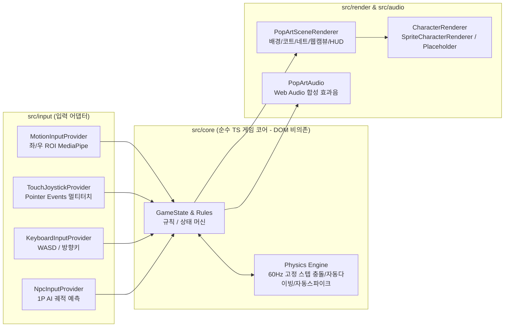

# 피카츄 배구 (Pop Art Edition) 설계 명세서 (Spec)

**작성일:** 2026-11-23  
**워크스페이스:** `c:\Antigravity\volleyball`  
**기술 스택:** TypeScript + Vite + HTML5 Canvas 2D + MediaPipe `@mediapipe/tasks-vision` (`PoseLandmarker`) + Web Audio API + Vitest  

---

## 1. 프로젝트 개요 및 핵심 요구사항

1. **두 가지 조작 모드 지원**
   - **모션인식 모드 (Motion Mode)**: 웹캠 기반 포즈 인식으로 캐릭터 조종 (1P vs NPC, 2P 로컬 대전 모두 지원).
   - **터치패드 모드 (Touchpad Mode)**: 화면 내 다이나믹 조이스틱 기반 조작 (1P vs NPC, 2P 하단 좌/우 분할 멀티터치 모두 지원) + PC 테스트용 키보드(`WASD` / `방향키`) 동시 지원.
2. **모션인식 좌/우 분할 및 월경 무효화**
   - 웹캠 입력 화면을 좌/우 반(`0 ~ 50%`, `50% ~ 100%`)으로 물리적으로 분할하여 처리한다.
   - 한쪽 코트에 인식된 사람이 중앙선을 넘어 반대편으로 이동하거나 팔을 뻗어도, 반대편 캐릭터나 게임 판정에 어떠한 영향도 주지 않는다.
3. **모션인식 거리(크기) 게이트**
   - 인식된 사람의 크기가 반쪽 코트 대비 너무 커서 공이 떨어질 공간이 부족하면 `"STEP BACK! 멀리 떨어지세요"` 팝아트 경고 메시지를 띄우고 플레이를 대기/일시정지한다.
   - 일정 크기 임계치 이하로 작아져 0.5초간 유지되면 자동으로 플레이를 시작(또는 재개)한다.
4. **원작 피카츄 배구 룰 & 1P NPC 대전**
   - 1P 모드는 NPC AI와 대결한다.
   - 15점 선취 기본(5 / 10 / 15점 선택 가능), 득점자 측 서브, 공중 타격 시 방향성 자동 스파이크, 낮은 공 질주 시 자동 다이빙 슬라이딩을 지원한다.
5. **캐릭터 모델 & 스프라이트 (`033` 캐릭터)**
   - 렌더러 인터페이스(`CharacterRenderer`)로 게임 코어와 그래픽 구현을 분리한다.
   - 테스트 및 폴백용 `PlaceholderCharacterRenderer`와 함께, `C:\Antigravity\sprite\sprites\033\actions_out`의 실제 스프라이트 시트(`244×250` 셀, 4방향 행 구성)를 로드하는 `SpriteCharacterRenderer`를 적용한다.
   - 미보유 선택 모션(`win`, `lose`)은 기존 시트(`idle`/`jump_launch`, `hurt`)로 대체 처리하며 추후 파일 추가 시 manifest 등록만으로 반영된다.
6. **팝아트(Pop Art) 비주얼 스타일**
   - 전체 배경, 코트, UI 패널, 점수판, 경고 배너, 타격 이펙트를 벤데이 도트(Ben-Day Halftone Dots), 선버스트 패턴, 굵은 검정 잉크 외곽선(`3~4px #111111`), 하드 드롭 섀도우(`4px 4px 0 #111111`), 고채도 CMYK 팔레트로 통일한다.

---

## 2. 전체 아키텍처



### 디렉토리 구조

```text
c:\Antigravity\volleyball\
├── index.html
├── package.json
├── tsconfig.json
├── vite.config.ts
├── public/
│   └── sprites/
│       └── 033/                     # C:\Antigravity\sprite\sprites\033\actions_out 복사본
│           ├── actions_manifest.json
│           └── *_sheet.png (9종)
└── src/
    ├── main.ts                      # 앱 부트스트랩, 60Hz 루프, UI/모드 전환
    ├── style.css                    # 팝아트 폰트/버튼/패널 스타일
    ├── core/
    │   ├── types.ts                 # PlayerInput, GameState, MotionGateState 등
    │   ├── constants.ts             # 가상 해상도(864x608), 물리 상수, 임계치
    │   ├── physics.ts               # 고정 스텝 물리, 자동 스파이크, 자동 슬라이드
    │   ├── rules.ts                 # 점수, 서브, 매치 상태 머신
    │   └── npc.ts                   # 궤적 시뮬레이션 기반 NPC AI
    ├── input/
    │   ├── types.ts                 # InputProvider 인터페이스
    │   ├── keyboard.ts              # KeyboardInputProvider
    │   ├── touchJoystick.ts         # TouchJoystickProvider (1P/2P 다이나믹 조이스틱)
    │   ├── motionMath.ts            # 순수 함수: ROI 바운딩박스, 거리 게이트, 월경 필터 (테스트 가능)
    │   └── motion.ts                # MediaPipe PoseLandmarker + 좌/우 분할 ROI 캔버스
    ├── render/
    │   ├── palette.ts               # 팝아트 컬러 팔레트 & 패턴(Ben-Day, Sunburst) 생성
    │   ├── characterRenderer.ts     # CharacterRenderer 인터페이스 + PlaceholderCharacterRenderer
    │   ├── sprite033Renderer.ts     # 033 스프라이트 시트 로더 및 4방향/9액션 렌더러
    │   ├── effects.ts               # 코믹 버스트("POW!", "SMASH!"), 공 잔상, 셰이크
    │   └── sceneRenderer.ts         # 전체 캔버스 씬(코트, 네트, 공, 캐릭터, 조이스틱, 모션 오버레이)
    ├── audio/
    │   └── sound.ts                 # Web Audio API 신스 효과음 + 음소거
    └── ui/
        └── menu.ts                  # 팝아트 메인 메뉴, 모드/점수 선택, 에러/카메라 폴백 모달
```

---

## 3. 게임 코어 및 원작 룰 명세 (`src/core/`)

### 3.1 가상 좌표계 및 상수 (`constants.ts`)
- 가상 캔버스 크기: `WORLD_WIDTH = 864`, `WORLD_HEIGHT = 608` (원작 `432×304`의 정확히 2배 비율)
- 바닥 Y: `FLOOR_Y = 536`
- 네트: `NET_X = 432`, `NET_WIDTH = 16` (`left = 424`, `right = 440`), `NET_TOP_Y = 368` (높이 `168px`, 상단 반지름 `8px` 반원 캡)
- 플레이어 물리:
  - 반지름 `PLAYER_RADIUS = 38`
  - 이동 속도 `PLAYER_MOVE_SPEED = 420 px/s`
  - 점프 초기 속도 `PLAYER_JUMP_VY = -690 px/s`, 중력 `GRAVITY = 1650 px/s²`
  - 슬라이딩(다이빙) 속도 `SLIDE_SPEED = 620 px/s`, 지속 시간 `SLIDE_DURATION = 0.34s`, 쿨다운 `0.45s`
- 공 물리:
  - 반지름 `BALL_RADIUS = 32`
  - 중력 `BALL_GRAVITY = 1080 px/s²`, 최대 속도 `BALL_MAX_SPEED = 980 px/s`
  - 바닥 충돌 시: 득점 판정 (바운스 1회 후 `POINT_SCORED` 정지 연출 `1.1s`)

### 3.2 입력 계약 (`PlayerInput`)
```ts
export interface PlayerInput {
  /** -1 (왼쪽) ~ +1 (오른쪽). 터치/키보드에서 사용 */
  moveX: number;
  /** 모션인식 모드에서 사용: 본인 코트 내 목표 X 좌표(null이면 moveX 사용) */
  targetX: number | null;
  /** 점프 트리거 (누르고 있는 상태 또는 상승 엣지) */
  jump: boolean;
}
```
- `targetX`가 지정되면 `physics.ts`는 플레이어의 현재 `x`를 본인 코트 경계(`[minX, maxX]`)로 클램핑한 `targetX`를 향해 최대 `PLAYER_MOVE_SPEED`로 추적 이동한다.

### 3.3 자동 스파이크 & 자동 슬라이딩 (`physics.ts`)
- **공중 자동 스파이크 (버튼 없음)**:
  - 플레이어가 공중(`!player.isGrounded`) 상태에서 공과 충돌할 때 자동 발동.
  - 수평 입력(`moveX` 또는 이동 속도 방향)에 따라 상대 코트 안쪽으로 향하는 강한 스파이크 벡터(`speed = 860~940 px/s`, 하향 대각선 또는 깊은 직선)를 적용하고 `ball.isSpiked = true`, `player.animLock = 'spike'`(0.32s) 설정.
- **자동 다이빙 슬라이딩 (`slide`)**:
  - 별도 버튼 없이 아래 4가지 조건을 모두 만족할 때 자동 발동:
    1. `player.isGrounded && player.slideCooldown <= 0`
    2. 좌우 최대 속도에 가까운 질주 중 (`Math.abs(effectiveMoveDir) >= 0.85`)
    3. 공이 내 코트 영역에 있고 낙하 중이며 낮게 내려옴 (`ball.vy > 0 && ball.y >= FLOOR_Y - 190`)
    4. 공이 플레이어 진행 방향 앞쪽 `45px ~ 155px` 범위 내에 위치
  - 발동 시 진행 방향으로 `SLIDE_SPEED` 돌진(`0.34s`), `animState = 'slide'`, 히트박스를 낮춰 공을 위로 높게 띄워 살린다.

### 3.4 원작 규칙 상태 머신 (`rules.ts`)
- `MatchPhase`:
  - `MENU`: 타이틀/모드 선택
  - `WAITING_DISTANCE`: 모션인식 거리 체크 대기 (너무 큰 인원이 감지되었거나 플레이어 미감지 시)
  - `READY_SERVE`: 서브 위치 정렬 및 짧은 카운트다운 (`0.7s`)
  - `PLAYING`: 실시간 랠리
  - `POINT_SCORED`: 공 착지 후 득점 연출 (`1.1s`)
  - `MATCH_OVER`: 목표 점수(기본 15점, 설정 5/10/15) 도달 시 승리 화면
- 서브권: 직전 득점자(첫 세트는 P1) 코트 상공(`y = 160`)에서 공이 떨어지며 시작.

### 3.5 1P NPC AI (`npc.ts`)
- 공이 오른쪽(NPC) 코트로 넘어오거나 넘어올 예정일 때 `BALL_GRAVITY`와 벽 반사를 이용해 최대 2초 앞의 착지 예상 X(`predictedLandingX`)를 계산한다.
- 수비 기본 위치(`NET_X + 216`)와 `predictedLandingX` 사이를 부드럽게 추적한다.
- 공이 NPC 상단/전방 타격 반경 내에 있고 높이가 적절할 때 `jump: true`를 출력하며, 공중 접촉 시 자동 스파이크가 발동되도록 네트 방향(`moveX = -1`)을 입력한다.

---

## 4. 모션인식 모듈 명세 (`src/input/motion.ts`, `src/input/motionMath.ts`)

### 4.1 좌/우 반쪽 분할 (ROI Cropping)
- 웹캠 `<video>`를 좌우 반전하여 `640×240` 작업 버퍼에 그린 뒤:
  - **좌측 ROI 캔버스 (`320×240`)**: `x ∈ [0, 320)`만 잘라 좌측 `PoseLandmarker` (`numPoses: 1`)에 전달.
  - **우측 ROI 캔버스 (`320×240`)**: `x ∈ [320, 640)`만 잘라 우측 `PoseLandmarker` (`numPoses: 1`)에 전달.
- **1P 모드**: 사용자가 선택한 편(기본 P1=좌측)의 ROI만 추론을 실행하고, 반대편은 `NpcInputProvider`가 담당한다.

### 4.2 월경(넘어감) 무효화 로직 (`motionMath.ts`)
1. **물리적 픽셀 격리**: 좌측 추론기는 우측 픽셀을, 우측 추론기는 좌측 픽셀을 전혀 입력받지 못한다.
2. **경계 침범 랜드마크 필터링**:
   - 2P 모드에서 좌측 사람이 우측 영역으로 팔이나 몸을 뻗어 우측 ROI의 왼쪽 가장자리(`x < 0.14` in Right ROI)에 랜드마크가 잡히더라도, **기존 우측 플레이어의 `anchorCenterX`가 안정 영역에 존재한다면 경계 가장자리에서 새로 발생한 고립 랜드마크/급격한 중심 점프(`|newX - anchorX| > 0.35`)를 무시**한다.
   - 좌측 ROI의 오른쪽 가장자리(`x > 0.86` in Left ROI)도 대칭으로 동일하게 처리한다.
3. **코트 좌표 클램핑**: 추출된 `targetX`는 항상 해당 플레이어 코트 범위(`[PLAYER_RADIUS + 8, NET_LEFT - PLAYER_RADIUS - 8]` 또는 우측 대칭)로 엄격히 클램핑된다.

### 4.3 크기(거리) 판정 & 플레이 게이트 (`motionMath.ts`)
- 각 활성 ROI의 유효 포즈 랜드마크(가시성 `visibility >= 0.45`인 머리·어깨·팔꿈치·손목·엉덩이·무릎)로부터 정규화 바운딩 박스 `[minX, maxX]`, `[minY, maxY]`를 구한다:
  - `widthRatio = maxX - minX` (반쪽 화면 너비 대비 비율)
  - `heightRatio = maxY - minY` (반쪽 화면 높이 대비 비율)
- **판정 임계치 (히스테리시스 적용)**:
  - **너무 가까움 (`TOO_CLOSE`)**: `widthRatio > 0.58 || heightRatio > 0.85`
  - **적정 거리 복귀 (`OK`)**: `widthRatio <= 0.48 && heightRatio <= 0.76` 상태가 **`0.5s` 이상 연속 유지**될 때
- `TOO_CLOSE` 상태가 한 명이라도 발생하면 `MatchPhase`를 `WAITING_DISTANCE`로 전환해 공/물리를 일시 정지하고, 해당 반쪽 화면 위에 팝아트 경고 배너(**"STEP BACK! 너무 가까워요 — 멀리 떨어지세요"**)와 실시간 크기 게이지를 띄운다. 조건을 충족하면 `"OK! START!"` 알림 후 자동 시작/재개된다.

### 4.4 포즈 → 조작 매핑
- **좌우 이동**: 양쪽 어깨·엉덩이 중심 `torsoCenterX`에 EMA 필터(`alpha = 0.35`)를 적용해 `targetX`로 변환.
- **점프**:
  - 최근 1.5초 안정 자세의 `baselineHipY` / `baselineShoulderY` 대비 현재 높이가 임계치(`0.06` 이상 급상승)를 넘거나,
  - 양손목 중 하나가 머리(`nose.y - 0.04`) 위로 올라가면 `jump = true` 트리거.

---

## 5. 터치패드 다이나믹 조이스틱 명세 (`src/input/touchJoystick.ts`)

- **Pointer Events 멀티터치**:
  - 캔버스(또는 전체 터치 오버레이)에 `touch-action: none` 적용.
  - `pointerId` 맵으로 P1/P2 동시 터치를 독립 추적한다.
- **조작 영역 분할**:
  - **1P 모드**: 화면 전체 영역에서 첫 터치 지점이 P1 다이나믹 조이스틱 원점(`originX, originY`)이 됨.
  - **2P 모드**: `clientX < viewportWidth * 0.5`에서 시작한 터치는 P1에, `clientX >= viewportWidth * 0.5`에서 시작한 터치는 P2에 바인딩. 각 영역 당 1개의 활성 조이스틱만 유지.
- **동적 조이스틱 벡터 계산**:
  - 최대 반경 `MAX_RADIUS = 56px`, 데드존 비율 `DEADZONE = 0.15`
  - `dx = clamp(currX - originX, -MAX_RADIUS, MAX_RADIUS)`, `dy = clamp(currY - originY, -MAX_RADIUS, MAX_RADIUS)`
  - `normX = dx / MAX_RADIUS`, `normY = dy / MAX_RADIUS`
  - `moveX`: `Math.abs(normX) < DEADZONE ? 0 : normX`
  - `jump`: `normY < -0.45` (위쪽으로 밀면 점프, 좌상/우상 대각선은 이동+점프 동시 발동)
  - `pointerup` / `pointercancel` 시 즉시 리셋 및 조이스틱 UI 소멸.

---

## 6. 팝아트 비주얼 & `033` 스프라이트 명세 (`src/render/`)

### 6.1 팝아트 디자인 토큰 (`palette.ts`)
- 메인 배경: 일렉트릭 시안 `#00D4FF` ↔ 선버스트 크림 `#FFF3B0` 방사형 광선 + 반투명 벤데이 도트 패턴
- 코트 바닥: 핫 오렌지/옐로우 `#FFB703` 모래코트 + 굵은 검정 잉크 경계선(`4px #111111`) + 하프톤 그림자
- UI 패널/배지: `#FFFDF5` 바탕, `4px solid #111111`, `box-shadow: 5px 5px 0 #111111`
- P1 액센트: 일렉트릭 옐로우 `#FFE600` / P2 액센트: 핫 마젠타 `#FF2E93` (스프라이트 하단 링·코트 배지·아웃라인 오라로 1P/2P 명확히 구분)
- 코믹 이펙트 (`effects.ts`): 스파이크 시 `"SMASH!"` / `"POW!"`, 자동 다이빙 시 `"DIVE!"`, 득점 시 `"POINT!"`, 거리 경고 시 `"STEP BACK!"` 버스트 배지 + 방사형 속도선 + 100ms 캔버스 셰이크.

### 6.2 `033` 스프라이트 시트 규격 (`sprite033Renderer.ts`)
- 소스 경로: `C:\Antigravity\sprite\sprites\033\actions_out\` → 프로젝트 `public/sprites/033/`로 복사하여 Vite 정적 에셋으로 서빙.
- 시트 공통 규격: **셀 크기 `244 × 250 px`**, **4개 방향 행 (`0: DOWN`, `1: RIGHT`, `2: UP`, `3: LEFT`)**.
- 상태 ↔ 시트 매핑:

| 게임 캐릭터 상태 | 사용 시트 | 프레임 / FPS | 행(Row) 선택 규칙 |
| --- | --- | --- | --- |
| `idle` | `idle_sheet.png` | 4f / 7fps | `DOWN(0)` 또는 시선 `RIGHT(1)`/`LEFT(3)` |
| `walk` | `walk_sheet.png` | 8f / 11fps | `facing === 1 ? RIGHT(1) : LEFT(3)` |
| `run` | `run_sheet.png` | 8f / 12fps | `facing === 1 ? RIGHT(1) : LEFT(3)` |
| `jump_launch` | `jump_launch_sheet.png` | 4f / 12fps | `facing === 1 ? RIGHT(1) : LEFT(3)` |
| `air_float` | `air_float_sheet.png` | 4f / 10fps | `facing === 1 ? RIGHT(1) : LEFT(3)` |
| `spike` | `spike_sheet.png` | 5f / 12fps | `facing === 1 ? RIGHT(1) : LEFT(3)` |
| `slide` | `slide_sheet.png` | 5f / 10fps | `facing === 1 ? RIGHT(1) : LEFT(3)` |
| `attack` | `attack_sheet.png` | 6f / 10fps | 지상 타격 시 짧은 연출 (`facing` 방향) |
| `hurt` | `hurt_sheet.png` | 5f / 10fps | 실점/피격 시 (`DOWN(0)`) |
| `win` (선택 추가) | 추후 `win_sheet.png` (현재 `idle`/`jump_launch` 정면 대체) | - | `DOWN(0)` |
| `lose` (선택 추가) | 추후 `lose_sheet.png` (현재 `hurt` 마지막 프레임 대체) | - | `DOWN(0)` |

- 스프라이트 미로드 시 또는 헤드리스 테스트용으로 `PlaceholderCharacterRenderer`가 동일 `CharacterRenderer` 인터페이스로 동작한다.

---

## 7. 테스트 및 검증 계획

1. **단위 테스트 (Vitest)**:
   - `physics.test.ts`: 중력 낙하, 네트 상단/기둥 반사, 코트 경계 클램핑, 공중 자동 스파이크 발동, 바닥 근처 질주 시 자동 다이빙 슬라이드 발동 검증.
   - `rules.test.ts`: 득점 판정, 서브권 전환, 15점/커스텀 점수 승리 조건 검증.
   - `npc.test.ts`: 공 낙하 지점 예측 및 NPC 이동/점프 반응 검증.
   - `motionMath.test.ts`: 좌/우 ROI 좌표 변환, 경계 침범 랜드마크 무시(월경 차단), `widthRatio`/`heightRatio` 기반 `TOO_CLOSE` 및 `0.5s` 히스테리시스 해제 검증.
   - `touchJoystick.test.ts`: 1P/2P `pointerId` 독립 추적, 데드존, 위쪽 점프 임계치 검증.
2. **타입 및 빌드 검증**:
   - `npx tsc --noEmit`, `npm run build` 무오류 통과.
3. **브라우저 통합/시각 검증**:
   - Vite dev 서버 실행 후 1P/2P 터치패드(마우스/터치 시뮬레이션) 및 키보드 플레이, `033` 스프라이트 애니메이션, 팝아트 UI 및 이펙트, 모션인식 카메라 폴백/시뮬레이션 UI 확인.
